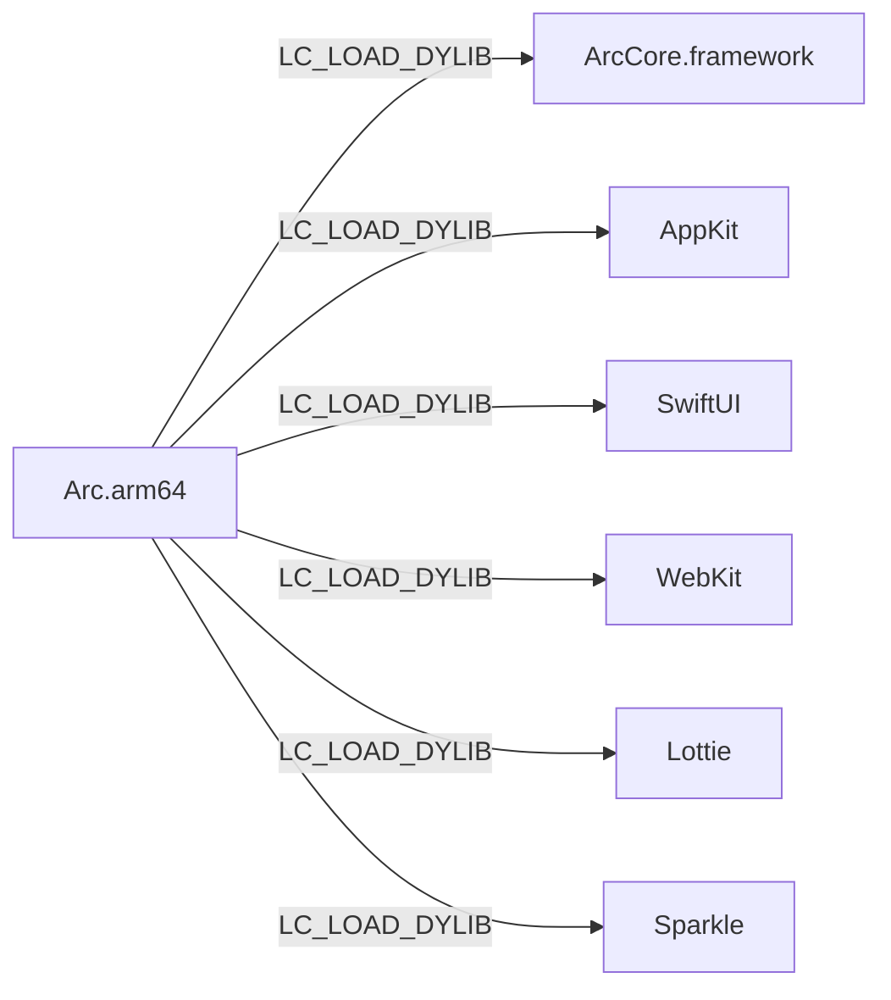

# Fronteiras nativas do Arc: dependências e sementes de bridge

## Resultado e cobertura

**Q01 parcialmente respondida:** o executável arm64 declara uma fronteira de ligação com `ArcCore`, AppKit, SwiftUI e WebKit. **Q05 parcialmente respondida:** imports de classes Objective-C fornecem sementes concretas do contrato Arc↔ArcCore, mas esta evidência não mostra handlers, métodos, chamadores nem callbacks executados. Nenhum fluxo UI→motor→UI foi demonstrado nesta etapa.

Fonte principal: `.local/evidence/arc-macho.json`, registro `inspect_macho`, Evidence **`ev_905a7257d7bedaa35fa74303666fb812c0c6a017f73b6c06daf38422f93611f5`**, doravante **M1**. Alvo: `.local/artifacts/Arc.arm64`, Mach-O arm64, SHA-256 **`95e6895ed8773f2bae861ad8230c90d4679ebe7001eac20f22d232e17c8c0d1a`**. A extração da fatia por `lipo` foi informada pelo coordenador; este relatório analisa o registro exportado dessa fatia, não reconstitui a cadeia de extração nem generaliza para x86_64.

O registro contém 86 dependências com cobertura declarada exaustiva, 8.039 entradas de imports e 863 de exports com cobertura **não exaustiva**. Quantidades contam entradas retornadas, não funções únicas nem chamadas. M1 combina `dyld_info` e `nm`; símbolos stripped, metadados encadeados ou não suportados pelo toolchain podem estar ausentes. `imports.total` e `exports.total` são nulos. Versão mínima declarada macOS 13.0, SDK 26.4 e linker LD 1266.8 descrevem metadados de build, não a versão do sistema em execução.

## Componentes e arestas comprovadas

| Origem | Destino declarado em M1 | Evidência | Conclusão delimitada |
| --- | --- | --- | --- |
| Arc.arm64 | `@executable_path/../Frameworks/ArcCore.framework/Versions/A/ArcCore` | `dependencies.items`, `LC_LOAD_DYLIB`; `current_version=8103.0.51`; 67 entradas de imports atribuídas a `ArcCore` | Há fronteira de ligação e referências a nomes de classes/API do ArcCore. A versão não prova a versão upstream do Chromium. |
| Arc.arm64 | AppKit e SwiftUI | `LC_LOAD_DYLIB`; 242 entradas atribuídas a AppKit e 1.613 a SwiftUI | O executável importa APIs das duas tecnologias de interface; a composição de views e responsabilidade de cada janela permanecem abertas. |
| Arc.arm64 | Foundation, Combine, runtimes Swift/ObjC | Dependências e imports: Foundation 1.067; Combine 385; libswiftCore 2.127; libobjc 73 | Existe superfície de ligação para código Swift e Objective-C; contagens não medem proporção do app nem tráfego entre módulos. |
| Arc.arm64 | WebKit | `LC_LOAD_DYLIB`; cinco entradas de imports, listadas abaixo | WebKit participa da superfície importada; isso não identifica o motor principal de abas. |
| Arc.arm64 | `@rpath/Lottie.framework/Versions/A/Lottie` | `LC_LOAD_DYLIB`; versão 1.0.0; 36 imports atribuídos a Lottie | Dependência declarada; uso efetivo em uma animação específica não demonstrado. |
| Arc.arm64 | `@rpath/Sparkle.framework/Versions/B/Sparkle` | `LC_LOAD_DYLIB`; versão 2.9.4; três imports atribuídos a Sparkle | Dependência declarada; fluxo de atualização não examinado. |
| Arc.arm64 | CloudKit e CoreData | `LC_LOAD_DYLIB`; 47 imports atribuídos a CloudKit e um a CoreData | Presença de APIs não estabelece sincronização ativa, conteúdo sincronizado ou store responsável. |
| Arc.arm64 | `@rpath/libswiftCompatibilitySpan.dylib` | `LC_LOAD_WEAK_DYLIB` | Referência fraca de compatibilidade; carregamento em runtime não observado. |

Das 86 dependências, 62 são `LC_LOAD_DYLIB` e 24 `LC_LOAD_WEAK_DYLIB`. Apenas os quatro caminhos relativos a executável/rpath acima constam na lista; os demais caminhos declarados são do sistema. Bibliotecas empacotadas adicionais podem ser ligadas transitivamente, incorporadas estaticamente ou carregadas dinamicamente; a lista do executável principal não resolve essas alternativas.

Todas as arestas representam declarações no Mach-O; o diagrama não é um grafo de chamadas nem de processos. Helpers e limites entre processos ainda precisam de inventário próprio.

## Sementes concretas para Q05

M1 `normalized_result.imports.items` contém as seguintes entradas com `source=ArcCore`, `name_status=exact`. O prefixo `_OBJC_CLASS_$_` comprova a referência importada ao objeto de classe; não descreve os selectors chamados. Nesta projeção, endereços dos imports são nulos.

| Grupo de investigação | Nomes importados, prefixados por `_OBJC_CLASS_$_` | Próxima evidência necessária |
| --- | --- | --- |
| Bootstrap/configuração | `ArcBrowserApplication`, `ArcBrowserApplicationConfiguration` | Localizar inicializador e criação da aplicação; atribuir relação ao `Arc.BrowserApp` declarado no plist. |
| Contexto/isolamento | `ArcBrowserContext`, `ArcBrowserContextAttributes` | Enumerar selectors/protocolos e chamadas que escolhem o contexto de uma view/aba; mapear IDs ao Profile do Arc. |
| Conteúdo e navegação | `ArcWebContentsConfiguration`, `ArcNavigation`, `ArcBackForwardListItem` | Encontrar classe dona do conteúdo e comando de navegação; identificar callback de URL/título/carregamento. O nome importado `ArcWebContentsConfiguration` não prova a implementação do conteúdo. |
| Sessão e agrupamento | `ArcSessionID`, `ArcSessionTab`, `ArcTabGroupInfo`, `ArcTabGroupResult` | Reconstruir identidade e conversão de modelo; ligar ao store da sidebar e à restauração. |
| Carregamento controlado | `ArcURLLoadConfiguration`, `ArcURLLoadCancellationToken` | Localizar criador, operação consumidora e cancelamento; distinguir carga de URL em serviço e navegação de aba. |
| Histórico | `ArcHistoryItem`, `ArcHistoryQueryOptions` | Identificar consulta/retorno e separar histórico de navegação de histórico lógico da sidebar. |
| Entradas de interface | `ArcKeyEventData`, `ArcAccessibilityTreeNode` | Determinar métodos e direção; nomes sozinhos não demonstram interceptação de teclado ou árvore acessível ativa. |

Outros quatro imports atribuídos a ArcCore são `_ArcErrorDomain`, `_CallWithEHFrame`, `_arcCategoryEnabledFlag` e `_emitTraceEvent`. Servem como sementes de erro/interoperabilidade/instrumentação; sua semântica e participação no fluxo da interface não foram analisadas.

WebKit apresenta exatamente estas cinco entradas no recorte retornado: `_WKErrorDomain`, `_OBJC_CLASS_$_WKWebViewConfiguration`, `_OBJC_CLASS_$_WKWebView`, `_OBJC_CLASS_$_WKWebsiteDataStore` e `_OBJC_METACLASS_$_WKWebView`. Para decidir se WebKit serve onboarding, conteúdo auxiliar ou abas principais, é necessário localizar os consumidores. Importação de uma classe não resolve essa escolha.

## Exports: pistas úteis e cautela de endereçamento

Os 863 exports foram demangled localmente com `xcrun swift-demangle --compact`, sem executar Arc. Essa transformação textual auxilia leitura dos nomes; não adiciona observação de código executado. M1 conserva os nomes mangled originais.

Sementes com nomes demangled:

- `SearchClientManager.SearchClientManager.(rankingData in _8F09D37337CEF32BA365C5949388EF5F)(for: ADKModels.BrowserContextID) -> CommandBarAdditionalRankingDataStoreClient.CommandBarAdditionalRankingData` liga tipos nominais de contexto e ranking na assinatura exportada; seguir consumidores antes de concluir relação com Profile ou dispatch de comandos.
- `SearchClientManager.SearchClientManager.(profileSpecificStates in _8F09D37337CEF32BA365C5949388EF5F).getter : [ADKModels.Profile : SearchClientManager.SearchClientManager.ProfileSpecificState]` fornece uma pista de estado indexado por Profile, sem provar cardinalidade, persistência ou isolamento de sessão.
- `PictureInPicture.PIPWindowController` aparece em exports de propriedades; `BaseModels.ThemeAwareHostingView` e `BaseModels.ThemeAwareHostingController` também aparecem. Isso fornece identidades nominais para Q12/interface, sem confirmar construção ou ciclo de vida de janelas.
- Nomes de `FirebaseStorage`, `FirebaseFunctions`, `DatadogInternal` e `EventSource` aparecem em exports. Eles não demonstram conexão, envio de dados ou conteúdo sincronizado nesta sessão.

**454 entradas de exports compartilham `address=0x1009539c8`.** Isso foi contado no registro, sem desassemblar esse endereço. Pode representar coalescimento, stubs ou outro efeito de ligação; sua causa está em aberto. Não usar esses endereços como prova de corpo funcional distinto nem como lista automática de funções a decompilar. Validar nome/endereço no binário e inspecionar corpo antes de rastrear a lógica.

## Próxima rodada de investigação

1. Consultar metadados Objective-C e selectors do executável/ArcCore para as sementes de contexto e navegação, conservando identidades de cada artefato. Objetivo: selecionar um comando e um callback concretos, sem iniciar análise integral por default.
2. Inspecionar imports/exports e identidade do próprio ArcCore para atribuir motor, interfaces e dependências transitivas. Chromium permanece hipótese nesta etapa específica; nomes de classes e versão declarada não bastam.
3. Relacionar um handler nativo de abrir/navegar ao método de ArcCore e seu retorno ao modelo da interface; registrar desconhecidos se chamadas dinâmicas impedirem a ligação estática.
4. Só então usar runtime sintético se a ordem temporal, thread/fila ou efeito visível permanecerem relevantes e desconhecidos.

Critério de avanço: Q01 requer atribuição demonstrada do motor e dos helpers; Q05 requer caminhos nos dois sentidos com métodos/chamadores. A lista de dependências responde à fronteira de ligação, mas não atende sozinha esses critérios completos.
