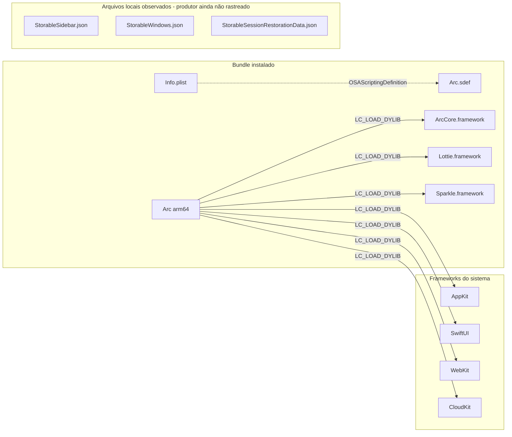

# Mapa técnico inicial do Arc para macOS

O material reunido identifica o bundle, suas principais fronteiras de ligação, o contrato de automação e parte da estrutura serializada de sidebar, Spaces e janelas. **O comportamento interno ainda não está reconstruído:** faltam os caminhos de chamada que ligam comandos, mutações, motor, gravação e restauração. As relações de dados abaixo foram observadas em arquivos; nenhuma ação de navegação, troca de Space ou ciclo de aba foi confirmada em runtime.

Este é um ponto de situação de 15/11/2026. A primeira análise Ghidra terminou com timeout; a tentativa seguinte concluiu e produziu um checkpoint reutilizado nas consultas nativas. As evidências e limitações de cada consulta estão nos relatórios especializados e em `.local/evidence/`; o estado operacional está em `.local/checkpoint.json`. O [caminho candidato de troca de aba](switch-tab-preferences.md) e a [amostra da fila de eventos em runtime](runtime-event-loop.md) acrescentam observações posteriores ao levantamento inicial.

## Identidade e fontes

Alvo instalado: `/Applications/Arc.app`, bundle `company.thebrowser.Browser`, versão **1.172.2**, build **90755**, classe principal declarada `Arc.BrowserApp`. O executável universal contém x86_64 e arm64; SHA-256 `c2906e92838b7b07451a54a0e3b151a59492347ebd0050b181524e283cbaf7a2`. A fatia arm64 extraída tem SHA-256 `95e6895ed8773f2bae861ad8230c90d4679ebe7001eac20f22d232e17c8c0d1a`, UUID `10ED4B9B-6BFE-34D3-AD7F-CCA121AB7592`. Resultados da fatia não se estendem automaticamente a x86_64.

| Referência | Conteúdo e autoridade |
| --- | --- |
| [Inventário](inventory.md) | Hashes, versões, helpers, frameworks e declarações dos plists, obtidos do bundle. |
| **P1:** `ev_6973e351e9e96a245e57b3fa100a02a253ebe3825377c32a21bd4f2233215451` | REA `inspect_plist`, em `.local/evidence/arc-macho.json`; declarações do plist, sessão de recursos sem identidade do executável. |
| **M1:** `ev_905a7257d7bedaa35fa74303666fb812c0c6a017f73b6c06daf38422f93611f5` | REA `inspect_macho`, mesmo bundle de Evidence; dependências/imports/exports da fatia arm64. [Interpretação](native-boundaries.md). |
| [Estrutura de persistência](persistence-schema.md) | Leitura estrutural e comparação agregada de três JSONs locais, sem reproduzir conteúdo pessoal. Esquemas derivados e relações agregadas em `.local/evidence/persistence/`; não são IDs REA nem schemas universais. |
| [Sementes Swift](swift-seeds.md) | Corpus de strings/símbolos local; 182 ocorrências selecionadas, offsets e hash em `.local/evidence/swift-seeds/strings-selected.jsonl`. |
| [Contrato de automação](automation-contract.md) | Parse estático de `Arc.sdef`, com classes, comandos, chaves e selectors declarados. |
| **D1:** `ev_59948e08664b7288cfb0326952fb45891a7e70220447a74bc05d8afceb1fb483` | REA `inspect_native_dispatch_metadata`, `.local/evidence/arc-dispatch-metadata.json`; inventário estático, não chamadas observadas. [Recorte interpretado](dispatch-metadata.md). |
| **R1:** `ev_1c8bedbb5539c383f0585f38d3c8037ae2c9254d8ffe865fdf1f4262d05842b8` | REA `capture_process_scenario`, `.local/evidence/runtime-automation-probe.json`; consulta AppleScript terminou com timeout. [Registro de execução](runtime-probes.md). |

## Arquitetura estática demonstrada

M1 retorna **86 dependências** com cobertura declarada exaustiva: 62 `LC_LOAD_DYLIB` e 24 `LC_LOAD_WEAK_DYLIB`. Foram retornados **8.039 imports e 863 exports**, ambos não exaustivos. Arestas sólidas no diagrama são comandos de carga no executável; a aresta pontilhada é declaração de recurso. Nenhuma representa chamada ou fluxo de dados executado.

O executável importa 67 nomes atribuídos a ArcCore, incluindo classes Objective-C `ArcBrowserApplication`, `ArcBrowserContext`, `ArcBrowserContextAttributes`, `ArcWebContentsConfiguration`, `ArcNavigation`, `ArcSessionTab`, `ArcSessionID` e `ArcBackForwardListItem`. Isso fornece uma fronteira concreta para investigar aplicação/contexto/conteúdo/sessão. A interpretação funcional de cada classe e os selectors usados permanecem abertos.

ArcCore declara versão de bundle `157.0.8103.51`; sua dependência no Mach-O declara `8103.0.51`. Essas são representações de versão diferentes nas respectivas fontes. A [inspeção do próprio ArcCore e dos processos](engine-and-processes.md) encontrou marcadores Chromium e recursos dessa família enumerados em runtime. Isso sustenta a atribuição da família do stack; a correspondência exata com uma versão upstream continua desconhecida. Os cinco imports atribuídos a WebKit incluem `WKWebView`, `WKWebViewConfiguration` e `WKWebsiteDataStore`; isso exige localizar consumidores antes de atribuir o motor de abas. AppKit e SwiftUI são ambas tecnologias importadas, sem atribuição demonstrada de views específicas.

FirebaseFirestoreInternal, Sentry, gRPC e outras bibliotecas estão no bundle. CloudKit é dependência declarada do executável. Essa combinação, nomes em serialização e nomes de fontes embarcados não determina qual backend está ativo nem prova tráfego de rede.

O inventário D1 retorna 852 entradas de classes Objective-C, 2.885 de implementações de dispatch e 2.121 de ivars. São contagens de entradas retornadas, não código executado ou cobertura de todos os tipos Swift. As listas de declarações/conformances/slots Swift desse resultado estão vazias; isso não demonstra ausência de Swift no aplicativo. A faceta Objective-C é parcial; ponteiros relativos atingiram o orçamento e facetas Swift ficaram parciais com orçamento esgotado. As contagens não estabelecem inventário completo. O [recorte interpretado](dispatch-metadata.md) fornece pontos estáticos concretos:

| Área | Classe/seletor e endereço de implementação em D1 | Limite |
| --- | --- | --- |
| Entrada de navegação por automação | `AppleScriptTabWrapper.setURL:` — `0x100458c9c` | Associação selector→implementação; o corpo ainda não foi seguido até o destinatário. |
| Seleção nativa | `Arc.BrowserWindow.switchToTab:` — `0x10015002c` | Implementação candidata para investigar seleção; relação com motor não demonstrada. |
| Retorno nominal de navegação | `ADK.WebContentChromium.webContents:didCommitNavigation:` — `0x100540f98` | Callback candidato; emissor e consumidor ainda precisam ser identificados. |
| Retorno nominal de restauração | `ADK.ChromiumBrowser.browser:didRestoreWebContents:withSessionId:` — `0x100534ee8` | Assinatura indica vocabulário de conteúdo/sessão, sem provar fluxo executado. |
| Ciclo nominal da sessão | `ADK.BrowserContextDelegateBridge.didFinishRestoringSession:` — `0x1004e6b90` | Não equivale automaticamente à restauração dos JSONs locais. |

D1 também contém ivars `_sidebarStorableDataStore` e `_windowsStore` em `Arc.RestoreSidebarDataFlow`; `browserContextID` em `ADK.ChromiumBrowser`; e `navigationDelegate`/`webView` em `ADK.WebContentChromium`. Isso aproxima as perguntas de objetos concretos. A ligação objeto→store ou delegate→consumidor ainda exige leitura dos corpos. Os nomes ADK com `Chromium` fortalecem a hipótese de uma camada adaptadora Chromium; não confirmam, sozinhos, chamada da biblioteca ArcCore ou versão upstream.

## Processos observados

O [snapshot de processos e arquivos mapeados](engine-and-processes.md) encontrou Arc PID 71319 com 23 filhos dentro de ArcCore.framework, sendo 18 `Browser Helper (Aperitif Renderer)` e 5 `Browser Helper (Aperitif)`. Os nomes descrevem os executáveis observados. O papel de cada processo e as mensagens de IPC ainda exigem análise.

A amostra `lsof` de 15/11/2026 às 00h18min21s, horário de Fortaleza, reteve 104 caminhos de texto/memória dentro do bundle, incluindo ArcCore, Lottie, Sparkle, `chrome_100_percent.pak`, `chrome_200_percent.pak` e `resources.pak`. O registro é uma observação não atômica dos caminhos enumerados naquele instante. O hash do ArcCore coincide com o inventário inicial. A interpretação do stack como família Chromium é sustentada conjuntamente por esses recursos, marcadores do binário e identidades nominais ADK, preservando como lacuna a versão exata e o fluxo UI→motor→UI.

Os [metadados do ArcCore](arccore-contract.md) também identificam `ArcWebContentsNavigationController load:initiatorOrigin:` em `0x454fdc4`, `ArcWebContents navigationController` em `0x454a290` e `setNavigationDelegate:` em `0x45796b4`. O [desassemblado delimitado](arccore-call-sites.md) mostra adaptação de argumentos e transferências de controle, preservando desconhecida a ligação funcional com os callbacks ADK. Esses endereços pertencem à imagem ArcCore, com hash e espaço de endereçamento próprios.

A investigação do caso candidato `switchToNthTab` encontrou metadados compatíveis com `Dependency<UserDefaultsClient>` e nomes de configurações associados às posições 103 e 104. A análise estática associa uma dessas opções à composição dos contextos `topApp`, `pinned` e `unpinned`, e outra a um desvio numérico na nona posição. A identidade das closures e o efeito final ainda precisam de confirmação. [Preferências no caminho de troca](switch-tab-preferences.md).

## Relações de dados observadas

O [loop de eventos amostrado](runtime-event-loop.md) acrescenta uma observação de um segundo do processo Arc, com frames alternando entre Arc, ArcCore e AppKit. Os UUIDs coincidem com as imagens locais. A normalização usa slide `0x5dc000` para Arc e `0x123cdc000` para ArcCore. Três frames normalizados estão em intervalos candidatos próximos a entradas de `BrowserApp`; os limites de função e a atribuição exata permanecem por confirmar. A observação não registra uma ação de navegação ou uma transição de aba.

O [desassemblado de dois pontos de bridge](bridge-call-sites.md) acrescenta arestas estáticas concretas. O setter AppleScript `setURL:` em `0x100458c9c` chama `0x100458cf0`; o callback `webContents:didCommitNavigation:` em `0x100540f98` inclui uma chamada indireta em `0x10054102c` e uma direta para `0x100736cfc`. Os destinos funcionais e a ligação entre esses dois caminhos permanecem desconhecidos. Esses endereços permitem selecionar consultas ao Program Ghidra quando sua análise concluir.

A leitura estrutural cobre três arquivos reais de `~/Library/Application Support/Arc`. Hashes, tamanhos e mtimes coincidiram nas verificações antes/depois, mas a coleta não é snapshot atômico nem conjunto transacional. O [relatório de persistência](persistence-schema.md) conserva os detalhes sem os valores pessoais.

| Estrutura | Observação nesta amostra | Alcance da conclusão |
| --- | --- | --- |
| Sidebar | Raiz tem `version`, `sidebar`, `sidebarSyncState`, `firebaseSyncState`; `sidebar.containers` inclui `items` e `spaces`. Itens têm `id`, `parentID`, `childrenIds`, `data` e `title`; variantes de `data` incluem `tab`, `list` e `itemContainer`. | São campos/variantes serializados observados; sem inferir tipos internos, ordenação ou finalidade completa. |
| Relações entre itens | Os 19 valores de `childrenIds` e 19 `parentID` string encontrados coincidiram com IDs de item, num conjunto de 24 IDs distintos. | Igualdade de valores na amostra; não comprova hierarquia válida globalmente, ausência de ciclos ou manutenção da relação pelo código. |
| Space/Profile | Objetos de Space têm `id`, `containerIDs`, `newContainerIDs` e `profile`; `profile.default` aparece como booleano. | Confirma estrutura aninhada observada; cardinalidade geral e isolamento de sessão desconhecidos. |
| Janela/Space | Objetos de `windows` têm `id` e `focusedSpaceID`; raiz tem `lastFocusedSpaceID`; um ID de foco de janela coincidiu com um dos dois IDs distintos de Space. | Vínculo por valor observado entre arquivos lidos separadamente; não prova atualização ou restauração da seleção. |
| Conteúdo de janela | `contents` inclui `splitViewState`; há `sidebarViewPreferences`. | Estados nominais serializados; criação, propriedade e ciclo de vida não recuperados. |
| Restauração | `mapping.keysToValues` tem números e objetos; objetos incluem `itemId`, `browser.windowID` e `browser.contextID.profile.default`. | Estrutura compatível com investigação de mapeamento item/janela/contexto; significado da alternância e algoritmo de restauração desconhecidos. |

Strings do executável acrescentam vocabulário candidato: `SidebarItemData`, `SidebarTab`, `SidebarTabGroup`, `SidebarMutation`, `SidebarItemMutator`, `SidebarSpaceMutator`, `SidebarDataStoreImpl`, `SidebarDataStoreTransaction`, `RestoreSidebarDataFlow` e `PersistedWebContentsLifecycleState`. A convergência entre nomes e campos ajuda a escolher buscas; **não liga automaticamente um tipo a um arquivo**. [Hipóteses de domínio](domain-hypotheses.md) separa propostas, alternativas e provas exigidas.

## Contrato de automação e tentativa runtime

`Arc.sdef` declara quatro classes: application, window, tab e space. Mapeia wrappers `AppleScriptWindowWrapper`, `AppleScriptTabWrapper` e `AppleScriptSpaceWrapper`; declara coleções, seleção de aba/Space, URL gravável e comandos como criar, contar, selecionar, navegar, recarregar, parar, executar JavaScript, fechar e focar. Esses comandos são uma interface declarada de automação; não estabelecem o dispatcher interno da Command Bar ou a implementação de navegação.

A consulta R1 pediu versão e contagens de janelas, Spaces e abas da janela frontal por `/usr/bin/osascript`, com timeout Apple Event de 15 segundos. O processo terminou com código 1 e mensagem `Esgotou-se o tempo limite do AppleEvent. (-1712)`; os frames registram o erro em aproximadamente 15,33 segundos. **Não retornou contagens nem confirmou funcionamento da automação.** A falha não identifica sua causa nem prova travamento geral do Arc. A captura não observou rede nem selecionou caminhos de filesystem; esses efeitos permanecem desconhecidos.

## Cobertura das perguntas

`Parcial` significa que há fatos relevantes, mas faltam critérios do [roteiro](questions.md). `Sementes` significa apenas nomes, declarações ou pistas para uma investigação. A cobertura inclui a amostra de fila de eventos indicada em Q01; comandos e transições de usuário continuam sem confirmação em runtime.

| Pergunta | Cobertura atual | Base concreta | Lacuna decisiva |
| --- | --- | --- | --- |
| Q01 Componentes | **Parcial, com amostra runtime** | Bundle, hashes, arquiteturas, dependências e interfaces importadas. | Atribuir implementação do motor, processos/helpers e chamadas entre componentes. |
| Q02 Sidebar | **Parcial estrutural** | Campos e referências de IDs na serialização; metadados de modelo, transação, mudanças e atualizações. | Propriedade, ordem e um fluxo mutação→consumidor→persistência. |
| Q03 Spaces/Profiles/janelas | **Parcial estrutural** | `SpaceModel.profile` e `BrowserContextID.profile` usam `Profile`; foco de janela e igualdade agregada de IDs. [Detalhes](sidebar-data-model.md). | Cardinalidades gerais, handler de troca e contexto/isolamento efetivo. |
| Q04 Ciclo de abas | **Parcial estática** | Modelo `SidebarTab` e configuração que distingue congelar, descartar e fechar. [Detalhes](tab-suspension.md). | Estados, precondições, transições e efeitos no motor. |
| Q05 Bridge nativa/motor | **Parcial de ligação** | 67 imports ArcCore; selectors/implementações ADK e AppleScript com endereços estáticos. | Métodos/chamadores de ida e callback de retorno à interface. |
| Q06 Persistência/restauração | **Parcial estática e estrutural** | Três JSONs e campos; dependências de sidebar e janelas ligadas aos nomes de arquivo; caminhos estáticos de decodificação, codificação e substituição. | Caminho resolvido em runtime, gatilhos, startup, formato completo e recuperação. |
| Q07 Comandos/atalhos | **Parcial estática** | SDEF, 92 casos de MainMenuAction e cadeia de switchToTab; identidade do caso apoiada por ABI e experimento. | Consumidor da ação, dispatcher de teclado/Command Bar e disponibilidade por contexto. |
| Q08 Autoarquivamento | **Sementes** | Nomes de thresholds por Profile e setter no executável. | Unidade, defaults, relógio, elegibilidade e momento de aplicação. |
| Q09 Sync | **Sementes** | Campos `sidebarSyncState`, `firebaseSyncState`, `encodedCKRecordFields`; CloudKit importado e caminhos nominais de sync. | Backend ativo, entidades, operações, IDs/versões, exclusão e merge. |
| Q10 Múltiplas janelas | **Parcial estrutural** | `windows`, foco e estados de conteúdo serializados; wrappers de automação. | Escopo de instâncias, compartilhamento e propagação entre janelas. |
| Q11 Migração/falhas | **Sementes** | `version`, nomes deprecated/decoding error e diagnóstico de restauração iCloud. | Branches efetivos de migração, fallback e recuperação. |
| Q12 Recursos auxiliares | **Sementes** | Recursos de onboarding, nomes de PiP, `splitViewState`, declarações de Little Arc. | Criação, integração com aba, teardown e estado persistente por recurso. |
| Q13 Subconjunto reproduzível | **Em aberto; opcional** | Há vocabulário e estrutura para propor escopo. | Contratos observáveis e escolhas próprias; priorizar concluir o mapa antes de implementar. |

## Próximas provas prioritárias

1. **Uma mutação completa (Q02/Q06).** Mapear a string `performSidebarMutations(on:newlyAddedItemIDs:newlyRemovedItemIDs:folderID:showNewItemsAsUnread:latestLiveItems:existingSidebarItems:instructions:newHiddenItems:)`, offset de arquivo `0x3a74160`, a xrefs/funções efetivas. Identificar a escrita em estado e um consumidor; depois buscar o store responsável.
2. **Um caminho de restauração (Q06/Q03).** Seguir `RestoreSidebarDataFlow`, offset `0x36c1410`, e a âncora ObjC `_TtC3Arc22RestoreSidebarDataFlow`, offset `0x3ffdff0`. Demonstrar fonte, decoder, chamador no startup ou outro contexto real, e destino do resultado.
3. **Uma transição de aba e sua bridge (Q04/Q05).** Seguir `restoreTab(options:)`, offset `0x3a7fd00`, até precondição e mutação; localizar eventual criação/reuso de conteúdo e contexto. Complementar com os corpos já endereçados de `AppleScriptTabWrapper.setURL:` (`0x100458c9c`) e `ADK.WebContentChromium.webContents:didCommitNavigation:` (`0x100540f98`), para buscar uma ida e um retorno concretos. Não presumir que a string seja função.
4. **Atribuir ArcCore e Profile (Q01/Q03).** Inspecionar identidade/imports/tipos do próprio ArcCore e uma chamada real de construção/seleção de `ArcBrowserContext`; separar entidade Profile de contexto do motor até a correspondência estar demonstrada.
5. **Retomar runtime somente com hipótese concreta.** Entender o limite da tentativa AppleScript e escolher observável sintético mínimo. O timeout é evidência da tentativa falha; não justifica repetir a mesma consulta sem mudança ou inferir causa. Ações de criar/fechar abas pessoais não são necessárias ao mapa estrutural.

Antes de decompilar, converter offset no arquivo em endereço virtual pela seção/segmento da fatia correta. M1 registra 454 exports no endereço compartilhado `0x1009539c8`; isso exige validar o corpo efetivo, não usá-lo como prova de 454 funções distintas. Novas conclusões devem registrar função/endereço, provedor, Evidence, alcance e desconhecidos. A análise Ghidra em andamento pode reduzir essas lacunas; sua mera inicialização não altera o grau de cobertura deste mapa.

A [consulta de automação isolada](runtime-probes.md#isolamento-da-consulta-de-janelas) retornou a versão 1.172.2, enquanto `count windows` reproduziu o timeout `-1712`. O sucesso da consulta de versão delimita a falha e mantém o funcionamento das coleções de janelas como lacuna.
